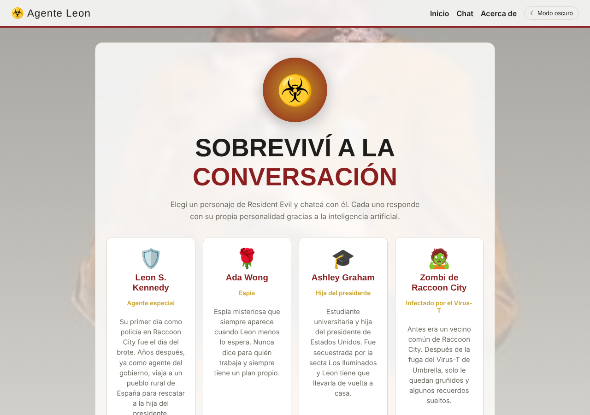
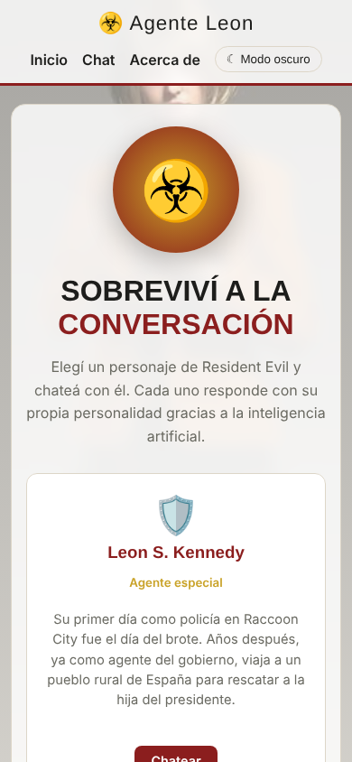
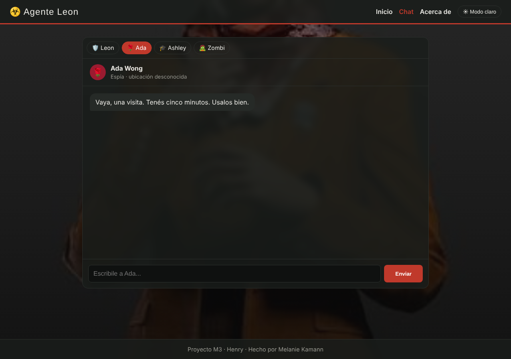
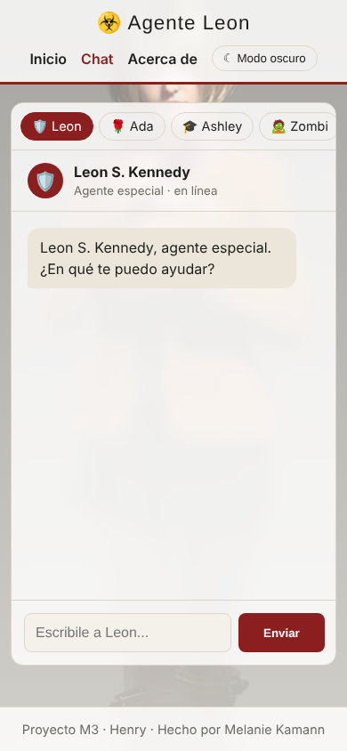

# ☣️ Agente Leon · Proyecto M3 (Henry)

SPA para chatear con personajes de Resident Evil (Leon S. Kennedy, Ada Wong, Ashley Graham y un zombi de Raccoon City). Cada personaje responde con su propia personalidad gracias a la API de **Gemini**, llamada desde una función serverless para que la API key nunca llegue al navegador.

🔗 **Deploy:** [AGREGAR_LINK_DE_VERCEL](https://AGREGAR_LINK_DE_VERCEL)

## Capturas

| Inicio (escritorio) | Inicio (celular) |
| --- | --- |
|  |  |

| Chat con Ada, modo oscuro (escritorio) | Chat con Leon (celular) |
| --- | --- |
|  |  |

## Funcionalidades

- **Router propio con History API** (`pushState` / `popstate`): rutas `/home`, `/chat`, `/about` y rutas con parámetro como `/chat/ada`. Funcionan también al entrar directo o recargar (gracias al rewrite de `vercel.json`).
- **4 personajes** con galería en el inicio y pestañas dentro del chat.
- **Chat con contexto:** se envía el historial completo, así el personaje recuerda la conversación. Cada personaje tiene su propio historial.
- **API key segura:** el cliente solo manda el id del personaje y el historial; la función serverless arma el *system prompt* y llama a Gemini con la clave guardada en variables de entorno.
- **Fallback entre modelos con timeout:** si un modelo de Gemini está saturado o tarda más de 12 s, se prueba con el siguiente.
- **Modo oscuro** que se recuerda entre visitas y **fondo con fotos** que cambia solo.
- **Diseño mobile first** con media queries `min-width`.

## Tecnologías

HTML · CSS · JavaScript (ES6+, módulos) · History API · Gemini API · Vercel Functions · Vitest

## Estructura

```
index.html            → estructura base (navbar, main, footer)
style.css             → estilos mobile first + modo oscuro
src/main.js           → router de la SPA
src/views/            → Home.js, Chat.js, About.js
src/data/             → characters.js (datos de cada personaje)
src/utils/            → api.js (sendMessage), theme.js, background.js
api/chat.js           → función serverless que llama a Gemini
lib/gemini.js         → lógica pura: buildContents y extractText
tests/                → tests unitarios con Vitest
.env.example          → modelo del archivo de variables de entorno
vercel.json           → redirige las rutas de la SPA a index.html
```

## Configurar el `.env`

1. Conseguí una API key gratis en [Google AI Studio](https://aistudio.google.com/apikey).
2. Copiá el archivo de ejemplo:
   ```bash
   cp .env.example .env
   ```
3. Abrí `.env` y reemplazá `tu_clave_de_gemini_aca` por tu clave. El archivo `.env` está en `.gitignore`, así que nunca se sube a GitHub.

En Vercel, la misma variable se carga en **Settings → Environment Variables** con el nombre `GEMINI_API_KEY`.

## Correr el proyecto en local

```bash
npm install
npm i -g vercel   # una sola vez
npm run dev       # levanta la app y la función /api/chat con vercel dev
```

## Tests

```bash
npm test             # corre todos los tests una vez
npm run test:watch   # los vuelve a correr al guardar cambios
```

Hay **11 tests unitarios** con Vitest:

- `tests/gemini.test.js` → `buildContents` (arma el `contents` de Gemini a partir del historial y descarta el saludo inicial) y `extractText` (saca el texto de la respuesta, incluso si viene vacía o rota).
- `tests/api.test.js` → `sendMessage`, mockeando `fetch` con `vi.fn()`: caso de éxito, que envíe bien el POST a `/api/chat`, error del servidor, error sin mensaje y falla de red.

## Desplegar en Vercel

1. Importá el repo en Vercel (**Add New → Project**, framework *Other*).
2. Agregá la variable de entorno `GEMINI_API_KEY`.
3. Deploy. `/home`, `/chat`, `/chat/ada` y `/about` funcionan con acceso directo.

## Uso de IA en el proyecto

Usé asistentes de IA (Claude) como apoyo durante el desarrollo:

- **Ideas y estructura:** para pensar la arquitectura de la SPA (router, vistas y función serverless) y cómo mantener la API key fuera del navegador.
- **Prompts de los personajes:** para redactar y ajustar las personalidades de Leon, Ada, Ashley y el zombi, y las reglas comunes (responder en español, en personaje y sin contenido sensible).
- **Errores:** para entender errores de la API de Gemini (modelos saturados, timeouts) y sumar el fallback entre modelos.
- **Devolución de la corrección:** para extraer la lógica pura a `lib/gemini.js`, escribir los tests con Vitest, pasar los estilos a mobile first, crear el `.env.example` y completar este README.

Todo el código lo revisé, lo probé y lo adapté al proyecto; la IA fue una herramienta de apoyo, no un reemplazo de entender lo que hace cada parte.

## Autora

Melanie Kamann · Estudiante de Desarrollo Web Full Stack en Henry · [GitHub](https://github.com/melaniekamann203-cmyk)

> Proyecto de fan sin fines de lucro. Resident Evil y sus personajes pertenecen a sus respectivos dueños.
